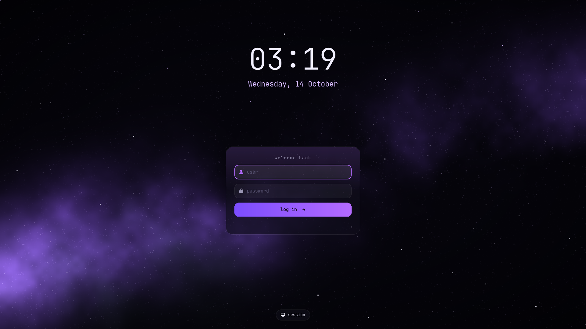
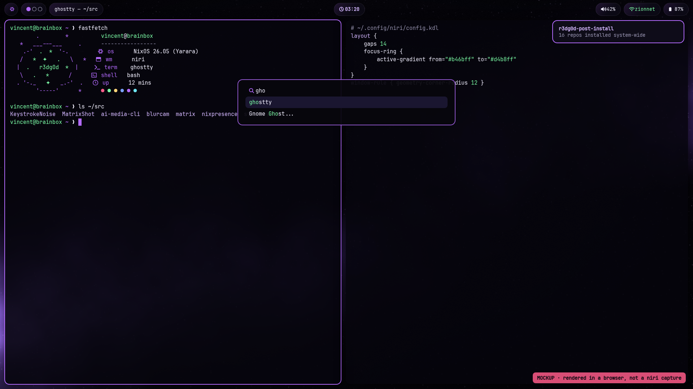

# dotfiles — deep-space

A niri rice for NixOS: near-black space, violet accents (`#b46bff`, same as
[r3dg0d.github.io](https://r3dg0d.github.io)), a soft green highlight and an original
procedurally generated nebula wallpaper.





<sub>The desktop image is a **mockup** rendered in a browser from the same colors and fonts, not a
capture of a running niri session. The SDDM image is the real theme rendered by
`sddm-greeter-qt6 --test-mode`.</sub>

> The previous NixOS workstation configuration (Hyprland, Ambxst, Ghostty CRT) is preserved on the
> [`nixos-workstation-archive`](https://github.com/r3dg0d/dotfiles/tree/nixos-workstation-archive) branch.

## What's inside

| Path | What |
|------|------|
| `palette/palette.json` | The single palette (names, hex, usage). Everything is generated from it |
| `templates/` | Config templates with `{{color}}` placeholders |
| `config/` | Rendered configs (what gets installed): niri, ghostty, waybar, fuzzel, mako, fastfetch, SDDM theme |
| `wallpaper/` | `deep-space.png` (3840×2160) and a 1440p copy for SDDM |
| `nix/rice.nix` | NixOS module: packages, Nerd Font, SDDM theme (`services.displayManager.sddm.theme = "deep-space"`) |
| `nix/sddm-theme.nix` | The SDDM theme as a package (Qt 6, imports only `QtQuick`) |
| `tools/render.py` | Re-renders `templates/` → `config/` after you change the palette |
| `tools/gen-wallpaper.py` | Regenerates the wallpaper (numpy + pillow; any size/seed) |
| `install.sh` | Copies (or `--link`s) the configs into `~/.config` |

### Highlights

- **niri:** 14px gaps, 12px rounded corners, violet→lavender gradient focus ring, soft shadows,
  slightly dimmed inactive windows. Starts xwayland-satellite, swaybg (wallpaper), waybar and mako.
  Default binds kept, with `Mod+T` / `Mod+Return` → ghostty, `Mod+D` → fuzzel,
  `Print` / `Mod+Shift+S` region screenshot, `Ctrl+Print` screen, `Alt+Print` window
  (saved to `~/Pictures/Screenshots` and copied).
- **ghostty:** JetBrainsMono Nerd Font 12, palette colors for all 16 ANSI slots, padding, 90% opacity
  with background blur, blinking bar cursor in violet.
- **waybar:** glassy pill modules: NixOS logo, niri workspaces, window title, clock, tray, audio,
  network, battery.
- **fuzzel / mako:** matching rounded, violet-bordered launcher and notifications.
- **fastfetch:** custom starfield logo and palette colors.
- **SDDM:** the wallpaper with twinkling stars, a big clock, a centered glass login card, session
  and power pills. No keyboard-layout box, so the stock theme's `zz` layout glitch is gone.

## Install

The easiest way is through [nixos-installer](https://github.com/r3dg0d/nixos-installer), which does
everything below (`install.sh --rice` on a fresh install, or `post-install.sh` on an existing system).

By hand on NixOS:

```bash
git clone https://github.com/r3dg0d/dotfiles ~/src/dotfiles
# 1. system side: packages, font, SDDM theme
#    add to imports in /etc/nixos/configuration.nix:  /home/<you>/src/dotfiles/nix/rice.nix
sudo nixos-rebuild switch
# 2. user side: configs into ~/.config (existing files are backed up first)
~/src/dotfiles/install.sh            # or --link to symlink, --dry-run to preview
```

Log out and pick **niri** in SDDM.

## Changing colors

Edit `palette/palette.json`, then:

```bash
python3 tools/render.py           # templates/ -> config/
python3 tools/gen-wallpaper.py    # optional: re-tint the wallpaper
./install.sh
```

## License

MIT, see [LICENSE](LICENSE). The wallpaper is original procedural artwork, also MIT.
