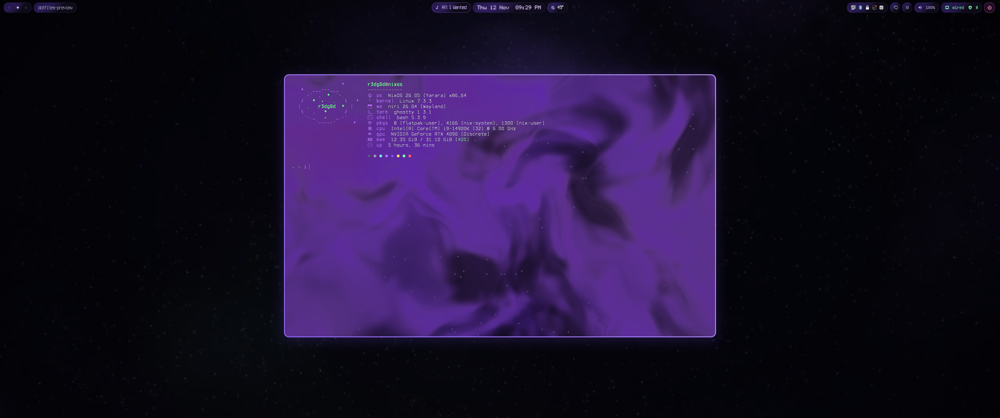
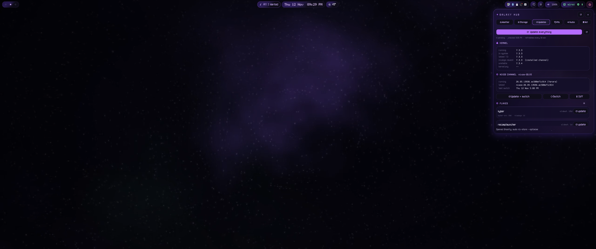
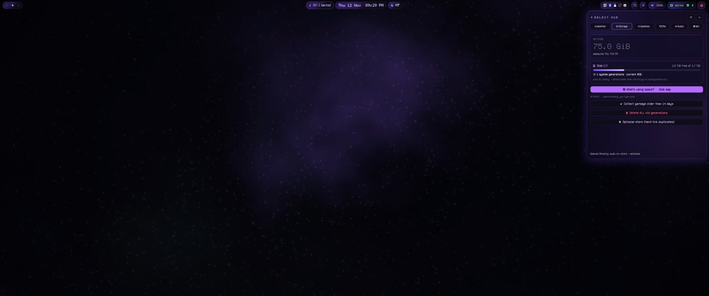
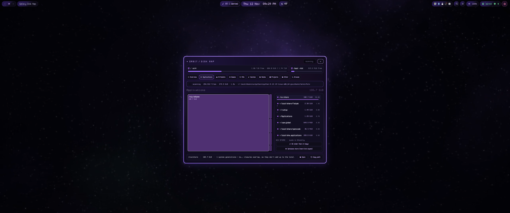
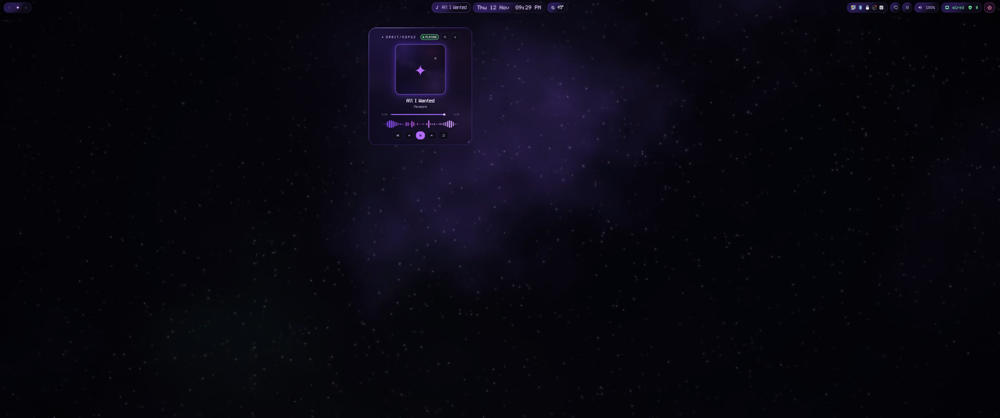
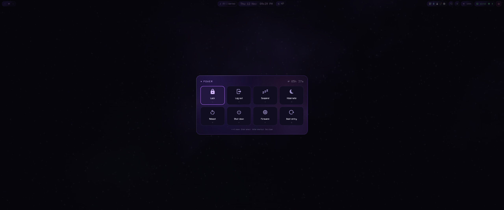
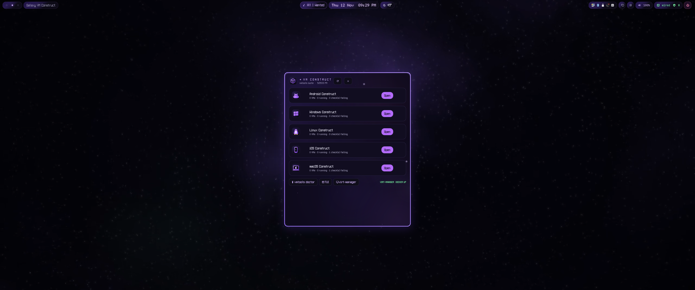
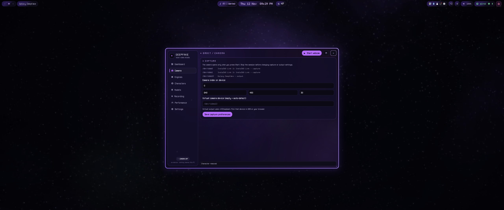
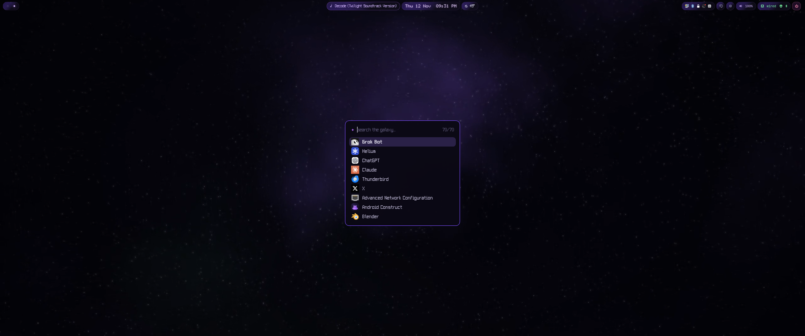
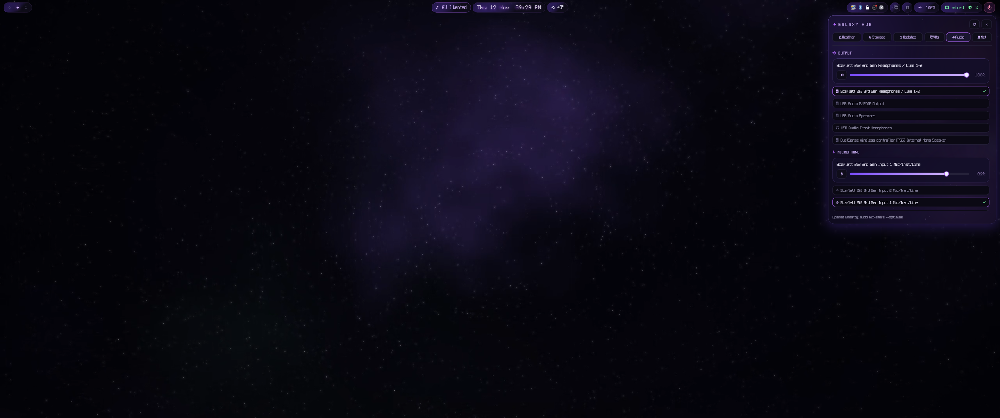

# dotfiles — deep-space

A niri rice for NixOS: near-black space, violet accents (`#b46bff`, same as
[r3dg0d.github.io](https://r3dg0d.github.io)), a soft green highlight and an original
procedurally generated nebula wallpaper. Ghostty runs a [GhostFX](https://github.com/r3dg0d/ghostfx)
nebula shader; waybar and the widgets are set in [Cellforge](https://github.com/r3dg0d/cellforge-font),
[Zerodot](https://github.com/r3dg0d/zerodot-font) and [NullType](https://github.com/r3dg0d/nulltype-font).

Plain NixOS, channel-based (nixos-26.05). No home-manager, no flakes required for the rice itself.



<sub>Captured on a running niri 26.04 session (3440×1440, scaled to 2560 for the repo). The
[SDDM theme](previews/sddm.png) is the real greeter rendered by `sddm-greeter-qt6 --test-mode`.</sub>

> The previous NixOS workstation configuration (Hyprland, Ambxst, Ghostty CRT) is preserved on the
> [`nixos-workstation-archive`](https://github.com/r3dg0d/dotfiles/tree/nixos-workstation-archive) branch.

## What's inside

| Path | What |
|------|------|
| `palette/palette.json` | The single palette (names, hex, usage). Everything is generated from it |
| `templates/` | Config templates with `{{color}}` placeholders |
| `config/` | Rendered configs (what gets installed): niri, ghostty + shader, waybar, fuzzel, mako, fastfetch, SDDM theme |
| `config/quickshell/` | Purple Galaxy Quickshell 0.3 widgets (see below) |
| `bin/`, `share/` | Launchers, `.desktop` entries and icons (`install.sh` places these) |
| `wallpaper/` | `deep-space.png` (3840×2160), a 1440p copy for SDDM, and `deep-space-live.mp4` (24 s seamless loop, 1440p H.264) |
| `nix/rice.nix` | NixOS module: packages, Nerd Font, SDDM theme (`services.displayManager.sddm.theme = "deep-space"`) |
| `nix/sddm-theme.nix` | The SDDM theme as a package (Qt 6, imports only `QtQuick`) |
| `nix/modules/` | Optional snapshots of the machine's rice-related NixOS modules (fonts, Quickshell, kernel, NVIDIA, …). Not imported by `rice.nix` — see [`nix/modules/README.md`](nix/modules/README.md) |
| `tools/render.py` | Re-renders `templates/` → `config/` after you change the palette |
| `tools/gen-wallpaper.py` | Regenerates the wallpaper (numpy + pillow; any size/seed) |
| `tools/gen-live-wallpaper.py` | Regenerates the live wallpaper (slow rotation, crossfaded so it loops seamlessly; needs ffmpeg) |
| `install.sh` | Copies (or `--link`s) the configs into `~/.config`, plus launchers, desktop entries and icons |

### Highlights

- **niri:** 14px gaps, 14px rounded corners, violet focus ring and tinted shadows, slightly dimmed
  inactive windows. Starts xwayland-satellite, the wallpaper (`~/.config/niri/wallpaper.sh`: live via
  mpvpaper, paused while hidden; falls back to swaybg with the still), waybar, mako, and the Galaxy
  hub / media / power daemons. Run `sh ~/.config/niri/wallpaper.sh static` for the still image. The
  wallpapers also live at `/run/current-system/sw/share/wallpapers` (from `nix/rice.nix`), so they
  work even if the copy into `~/.local/share/wallpapers` is missing.
  Default binds kept, with `Mod+T` / `Mod+Return` → ghostty, `Mod+D` / `Mod+Space` → fuzzel
  (Papirus-Dark icons, Cellforge), `Print` / `Mod+Shift+S` region screenshot, `Ctrl+Print` screen,
  `Alt+Print` window (saved to `~/Pictures/Screenshots` and copied). Galaxy hub pages on
  `Mod+Alt+W/S/U/V/A/N`, power menu on `Mod+Alt+P`, media on `Mod+Shift+M`.
- **ghostty:** [NullType](https://github.com/r3dg0d/nulltype-font) with JetBrainsMono Nerd Font as
  fallback, palette colors for all 16 ANSI slots, padding, 88% opacity with background blur, blinking
  bar cursor in violet, and the [GhostFX](https://github.com/r3dg0d/ghostfx) `nebula` shader
  (`config/ghostty/shaders/nebula-purple.glsl`, cyberpunk-purple / balanced / eco).
- **waybar:** glassy pills in Cellforge and Zerodot: NixOS / fuzzel logo, workspaces, window title,
  Kopuz now-playing, 12-hour clock, weather, tray, updates, VMs, storage, audio, network, power.
  Clicks open the matching Galaxy widget.
- **fuzzel / mako:** matching rounded, violet-bordered launcher (`✦  search the galaxy…`) and
  notifications.
- **fastfetch:** custom starfield logo and palette colors. (`install.sh` puts it back in
  `~/.config/fastfetch` if that directory is missing.)
- **SDDM:** the wallpaper with twinkling stars, a big clock, a centered glass login card, session
  and power pills. No keyboard-layout box, so the stock theme's `zz` layout glitch is gone.

## Quickshell widgets ("Purple Galaxy")

Live copies of the Quickshell 0.3 widgets from the running desktop. They share one look: a solid
`#0e0a1c` fill with a painted nebula + starfield (`Nebula.qml`, one Canvas raster, so no gradient
seam on rounded corners), thin luminous borders, status pills and Cellforge / Zerodot type.

Quickshell 0.3 IPC does not run a function named `show` — launchers call `open()` (or `toggle`).
Scripts use absolute paths and put `/run/wrappers/bin` ahead of `/run/current-system/sw/bin` so
`sudo` is the setuid wrapper, not the unusable copy in the system profile.

| Widget | What |
|--------|------|
| `galaxy/` | Kopuz music player (MPRIS, CAVA visualizer) + synced lyrics (LRCLIB, Genius fallback). `start.sh`; IPC `open` / `toggle` / `close` / `openLyrics` / `showMedia` |
| `galaxy-hub/` | Control center: weather, storage (with a **What's using space?** button), NixOS / kernel updater, VMs, audio, network (`hub.py` backend). The updater watches nixpkgs and kernel.org for any newer series (`7.3`, `7.4`, `8.0`, …), test-builds the pinned NVIDIA 595 module against it, then offers `nixos-rebuild boot` only (running kernel stays until you reboot; a failed rebuild restores the kernel file). `kernel-upgrade.sh`, `update-all.sh`, `update-flakes.sh` |
| `galaxy-power/` | Power menu overlay (lock, logout, suspend, hibernate, reboot, shutdown, firmware, UEFI). `Mod+Alt+P` |
| `galaxy-vm/` | VM "Construct" windows for the [vmtools](https://github.com/r3dg0d/vmtools) suite (Android / Windows / Linux / iOS / macOS) |
| `galaxy-disk/` | Disk map — a QDirStat / WinDirStat-style treemap with category tabs (Applications, AI Models, Games, VMs, Caches, Media, Projects, Other). `scan.py`; opens from the hub's storage page |
| `screenshot/` | Screenshot preview / editor |
| `deepfake/` | Front-end for [r3dg0d/deepfake](https://github.com/r3dg0d/deepfake) (also shipped in that repo's overlay) |
| `system-osd/` | Volume / brightness / mic OSD for hardware keys |
| `keystroke-noise/` | Popup for [KeystrokeNoise](https://github.com/r3dg0d/KeystrokeNoise) |
| `obs-picker/` | Screencast picker for xdg-desktop-portal-wlr |



















These are personal: several scripts use absolute `/home/r3dg0d` paths and expect tools from the
NixOS config (quickshell, cava, playerctl, python3, ghostty). Destructive actions always confirm in
the widget and run in a visible Ghostty so the sudo prompt is yours.

## Install

The easiest way is through [nixos-installer](https://github.com/r3dg0d/nixos-installer), which does
everything below (`install.sh --rice` on a fresh install, or `post-install.sh` on an existing system).

By hand, on a channel-based NixOS 26.05 (or similar) system **without home-manager**:

```bash
git clone https://github.com/r3dg0d/dotfiles ~/src/dotfiles
# 1. system side: packages, font, SDDM theme
#    add to imports in /etc/nixos/configuration.nix:  /home/<you>/src/dotfiles/nix/rice.nix
#    optional: fonts, Quickshell, Kopuz, widgets — see nix/modules/README.md
sudo nixos-rebuild switch
# 2. user side: configs into ~/.config (existing files are backed up first),
#    plus ~/.local/bin launchers, desktop entries and icons
~/src/dotfiles/install.sh            # or --link to symlink, --dry-run to preview
```

Log out and pick **niri** in SDDM. For the Galaxy look you'll also want the three fonts
(Cellforge, Zerodot, NullType) — import `nix/modules/fonts.nix` or install the TTFs from those
repos — and Quickshell 0.3 (`nix/modules/quickshell.nix`).

## Changing colors

Edit `palette/palette.json`, then:

```bash
python3 tools/render.py           # templates/ -> config/
python3 tools/gen-wallpaper.py    # optional: re-tint the wallpaper
./install.sh
```

## License

MIT, see [LICENSE](LICENSE). The wallpaper is original procedural artwork, also MIT.
The GhostFX nebula shader is MIT, from [r3dg0d/ghostfx](https://github.com/r3dg0d/ghostfx).
